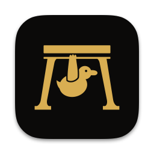
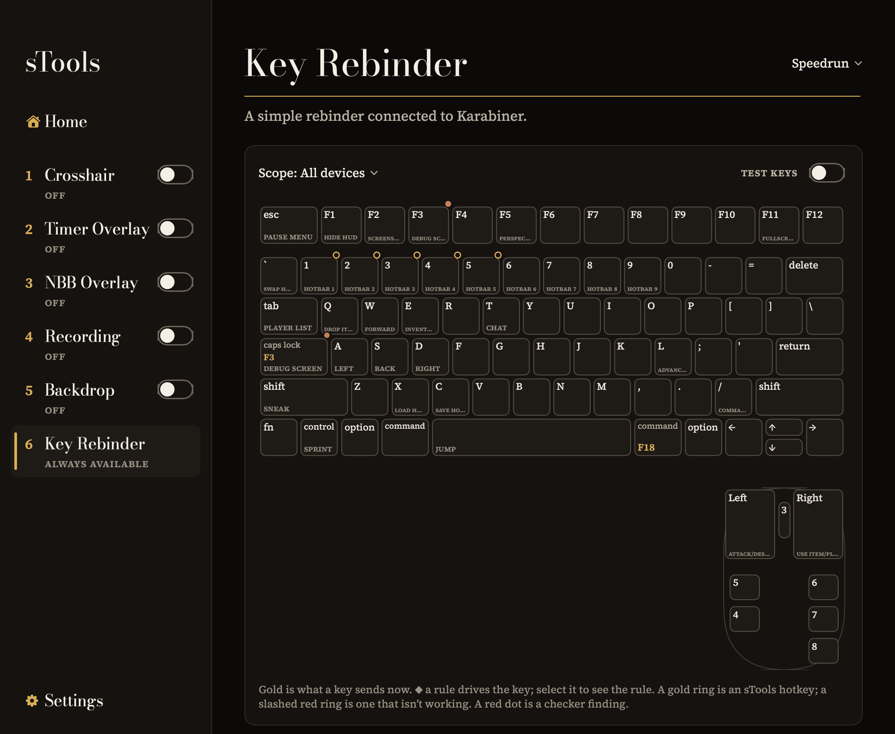
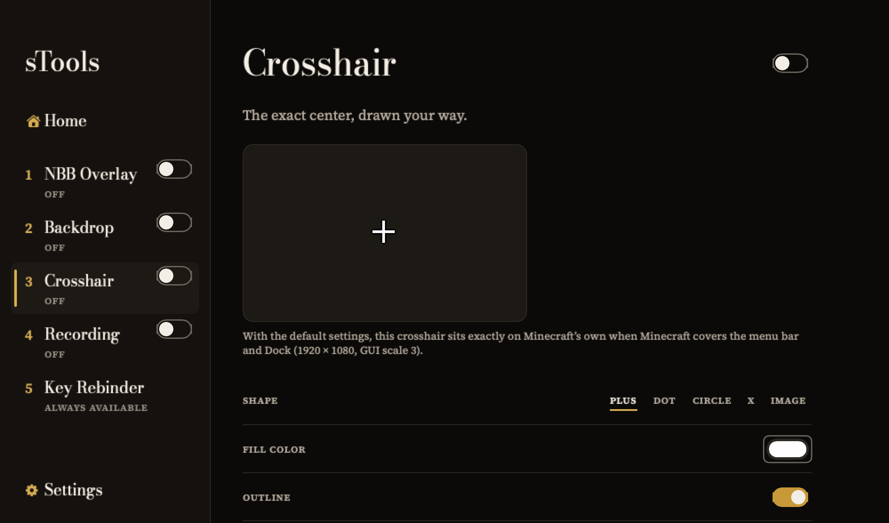

<p align="center">
  
</p>

<h1 align="center">sTools</h1>

<p align="center">
  <strong>A Mac app for Minecraft: Java Edition speedrunners.</strong>
</p>

<p align="center">
  <a href="#requirements"></a>
  <a href="#build-from-source"></a>
  <a href="LICENSE"></a>
</p>

<p align="center">
  <a href="#the-tools">Tools</a> ·
  <a href="#requirements">Requirements</a> ·
  <a href="#install">Install</a> ·
  <a href="#privacy">Privacy</a> ·
  <a href="#build-from-source">Build from source</a> ·
  <a href="#license">License</a>
</p>

sTools puts the tools around a speedrun into one native Mac app: a crosshair placed to the pixel, a countdown that pops up over the game on one key, Ninjabrain Bot's answer drawn over the game, a screen recorder that lays out a whole scene, a backdrop that hides everything behind Minecraft, and a visual editor for your Karabiner-Elements rebinds.

It's built for the game first. Overlays are click-through and never take focus from Minecraft, and anything with a reasonable alternative is a setting. The app itself is always dark, set in serif type with gold accents.

<p align="center">
  
</p>

## The tools

| | Tool | What it does | Needs |
|---|------|--------------|-------|
| 1 | [Crosshair](#crosshair) | Draws a crosshair at the exact center of the screen. | Accessibility |
| 2 | [Timer Overlay](#timer-overlay) | Pops a countdown over the game on one key, rings and leaves. | Accessibility |
| 3 | [NBB Overlay](#nbb-overlay) | Shows Ninjabrain Bot's current result over the game. | Accessibility, Ninjabrain Bot |
| 4 | [Screen Recording](#screen-recording) | Records Minecraft and your other sources on one canvas. | Accessibility, Screen & System Audio Recording |
| 5 | [Window Backdrop](#window-backdrop) | Hides everything behind the Minecraft window. | Accessibility |
| 6 | [Key Rebinder](#key-rebinder) | Shows and edits your rebinds on a drawn keyboard and mouse. | Karabiner-Elements 16+, to edit |

Each tool has its own page: a live preview where it helps, then its settings, with the rarely needed ones under **Advanced**. Switch tools on and off from the sidebar or their pages.

### Crosshair

Draws a click-through crosshair at the exact center of Minecraft's display, above everything, a full-screen game included. Pick a plus, dot, circle or X, or use your own image, SVG or PDF with one of five anchor points. Set its color and outline, and its size, thickness, gap and offset in real pixels. Out of the box it sits exactly on Minecraft's own crosshair at GUI scale 3 on a 1920 × 1080 display, with Minecraft filling the screen.

<p align="center">
  
</p>

### Timer Overlay

Press your Start-timer key and a countdown pops up over the game, 2:30 by default or any length you set. At zero it rings an alarm, pulses with each ring and leaves by itself; press again to restart, or twice quickly to cancel and switch Timer Overlay off, which sTools confirms over the game (the next press switches it back on and starts again). Choose a look (a plate, digits only or a compact pill) and its colors, font and size, and an alarm from macOS's sounds, four sTools alarms or your own files. Drag it into place with guides that show when it covers the hotbar, chat, toasts or anything else the rules need visible. It can also count down on the Dock icon, and it shows in your sTools recordings, with the alarm on its own track if you want it.

### NBB Overlay

Reads Ninjabrain Bot's local API and shows its current result in a small plate over the game: predictions with certainty and distance, your eye throws, the boat state, and its blind, divine and all-advancements modes. It shows only what Ninjabrain Bot itself shows. Drag it into place with snapping or type its position, and set its size and opacity.

### Screen Recording

Records Minecraft with sTools' overlays and backdrop, plus any windows, displays, cameras and web pages you arrange on one canvas. Sources don't have to be visible on your real screen. Sound from Minecraft, other apps and microphones is saved as one mixed track plus a track per source. Choose .mp4 or .mov, H.264 or HEVC, 30 or 60 fps. Files are written crash-safe. One key switches Screen Recording on and starts recording, and stops it when pressed again. "Recording started" shows over the game once the first frame is in the file, so a run started on it loses nothing. A press before then cancels the start ("Recording canceled · Screen Recording off"), and a start that fails says why over the game ("Recording couldn't start: … · Screen Recording off"); either way Screen Recording switches off. The stop switches Screen Recording off right away, camera light and recording indicator included, and says so over the game ("Recording stopped · Screen Recording off"); a small panel then asks for a name and Save or Delete for the finished file right over the game, ready to type in without leaving it.

### Window Backdrop

Covers the display Minecraft is on, edge to edge and behind the menu bar and Dock, and keeps the backdrop directly under the Minecraft window, so every other window disappears. Fill it with a color, a linear or radial gradient, or an image, and cover your other displays too, each with its own fill. Clicking it does nothing. Switch to another app and its windows come forward as usual; switch back and the backdrop is under Minecraft again.

### Key Rebinder

Draws your keyboard (ANSI, ISO or JIS, laptop or full size) and mouse with every Karabiner-Elements rebind on its key and your Minecraft keybinds underneath, read from `options.txt`. Edit rebinds for all devices or just one, change complex rules, manage profiles, and light up keys as you press them. A checker points out duplicates and rebinds that may break the speedrun remap rules, but never blocks a save. Every save backs up `karabiner.json` first and leaves the rest of it as it was.

## Around the tools

- **Global hotkeys.** Your own shortcuts, set at the top of Home, on each tool's page or right on a key in the Key Rebinder: any key, alone or with ⌃ ⌥ ⇧ ⌘, that switches a set of tools on or off together, starts the timer, or starts and stops a recording. By default they work only while sTools or Minecraft is in front, so other apps keep their own shortcuts (a browser's ⌘1 still switches tabs); Where hotkeys work, on Home, can make them work everywhere. Out of the box each tool but the Key Rebinder has a key in sidebar order, ⌘1–⌘5, and Key set, also on Home, swaps them all for ⌃1–⌃5, ⌥1–⌥5, F13–F17 or none; each tool's page says where its key works and which set it's from. Home lists them in sidebar order, and each tool keeps one key of its own: setting another asks whether to replace it. Recognizing Minecraft needs Accessibility, so until it's allowed they work only in sTools (Everywhere needs no permission). They show a small confirmation over the game. A hotkey's key goes to sTools instead of the game, so sTools warns you when it's one Minecraft uses. Hotkeys are on from the first launch, and they pause only while sTools records a key or you type in it.
- **The Prologue.** On first launch, an animated welcome, then help with each permission, Ninjabrain Bot and Karabiner-Elements, then a hands-on try of every tool. Back and Skip work on every step, and Help ▸ Replay Introduction runs it again.
- **Settings.** Open at login, sounds and volume, text size, accent color, update options, exporting and importing all your settings in one file, resetting the tools or all of sTools, and Copy Diagnostics for bug reports.
- **Reduce animations.** sTools animates nearly everything: switches spring, numbers roll, successes stamp a gold seal, and the sidebar glides with a soft tick for each row it passes (and a tap on a Force Touch trackpad). One switch in Settings ▸ Appearance turns every animation off, and macOS's Reduce motion does the same.
- **Updates.** sTools checks for new versions on its own and can download and install them when you quit. Settings ▸ Updates shows the version you're running, and Check for Updates… is there and in the app menu.

Close the window and your tools keep running; click the Dock icon to bring it back. Quitting turns everything off.

## Speedrun rules

Three tools touch the [Minecraft: Java Edition speedrunning rules](https://www.minecraftspeedrunning.com/public-resources/rules):

- The NBB Overlay shows only what Ninjabrain Bot itself shows, as rule A.11.7.a.i requires of tools that use its API. Its settings can hide or reformat information, never add to it.
- The Key Rebinder's checker cites the remap rules (A.10.1–A.10.4) when a rebind may break them. It only advises; you decide.
- Timer Overlay isn't on the rules' list of allowed tools, so ask the moderators before submitting runs that use it (A.11.9). It never reads or acts on the game, and its placement guides help keep the hotbar, chat, toasts and your in-game timer visible.

## Requirements

- **macOS 15 Sequoia or later.**
- **An Apple silicon or Intel Mac.** sTools is one universal app; Intel support is best effort.
- **Minecraft: Java Edition.** sTools is made for 1.16.1 with the official launcher or Prism Launcher.
- **[Ninjabrain Bot](https://github.com/Ninjabrain1/Ninjabrain-Bot)** for the NBB Overlay, with its API turned on (Settings ▸ Advanced in Ninjabrain Bot).
- **[Karabiner-Elements](https://karabiner-elements.pqrs.org) 16.0 or later** to edit rebinds and profiles. The keyboard, your Minecraft keybinds, the key tester and hotkeys on keys work without it.

### Permissions

The Prologue walks you through each one, and a tool's page offers **Allow…** when something it needs is missing.

| Permission | Why | Used by |
|------------|-----|---------|
| Accessibility | Finds the Minecraft window and follows it: where it is, which display it's on, whether it has focus. Hotkeys use it to recognize Minecraft in front. | Crosshair, Timer Overlay, NBB Overlay, Screen Recording, Window Backdrop, hotkeys in Minecraft |
| Screen & System Audio Recording | Records Minecraft and the windows and displays you add. macOS may ask you to reopen sTools after you allow it. | Screen Recording |
| App audio | Records the sound of Minecraft and other apps. | Screen Recording |
| Microphone | Records your voice, once you add a microphone. | Screen Recording |
| Camera | Puts your camera on the canvas, once you add one. | Screen Recording |

Without Accessibility, the tools that need it stay off and hotkeys work only in sTools, unless Where hotkeys work is set to Everywhere; the Key Rebinder works without it. sTools never asks for Input Monitoring: hotkeys go through macOS's own hotkey system, and the key tester only watches sTools' own window.

## Install

1. Download the latest DMG from the [releases page](https://github.com/ducky8x/sTools-releases/releases). Releases will appear there; the first beta, 0.1.0, goes to testers before a public release.
2. Open the DMG and drag **sTools** onto **Applications**.
3. The first time you open sTools, macOS blocks it, because sTools is signed with ducky's own self-signed certificate rather than notarized by Apple. To let it through:
   1. Open sTools from Applications, then click **Done**.
   2. Go to **System Settings ▸ Privacy & Security**.
   3. Click **Open Anyway**, then confirm.

After that it opens normally. Every release is signed with the same certificate, so macOS keeps the permissions you've granted when sTools updates itself.

## Privacy

sTools has no accounts, analytics or telemetry. It works with what's already on your Mac:

- **Minecraft's window**, through Accessibility: where it is and whether it has focus, so the overlays and the backdrop can follow it.
- **Minecraft's `options.txt`**, read-only, to label keys with their game actions.
- **Karabiner-Elements' `karabiner.json`**, to draw your rebinds. sTools writes to it only when you change something, after saving a backup in `~/Library/Application Support/sTools/Karabiner Backups` (the newest 20 are kept).
- **Ninjabrain Bot's local API** at `localhost:52533`, read-only.

Settings live in `~/Library/Application Support/sTools`, and recordings go to `~/Movies/sTools` unless you choose another folder. sTools goes online only to check for updates, and to load any web page you add to a recording yourself. Copy Diagnostics puts a report on your clipboard and sends nothing.

## Build from source

sTools is a Swift package (Swift 6, SwiftUI and AppKit) developed with the Xcode 27 beta. Run these from the repository root:

```sh
# Use Xcode's toolchain: the Command Line Tools alone lack Swift Testing's macros.
export DEVELOPER_DIR=/Applications/Xcode-beta.app/Contents/Developer

swift build                     # compile every module
swift test                      # run the tests
scripts/build-app.sh debug      # build/sTools.app for this Mac: the app you actually run
scripts/build-app.sh release    # build/sTools.app as a universal (Apple silicon and Intel) release
scripts/build-dmg.sh            # wrap build/sTools.app in the styled DMG
```

- `swift build` alone doesn't make the app. `scripts/build-app.sh` assembles `build/sTools.app` with its icon and resources, then signs it.
- **Signing:** `build-app.sh` signs only with a code-signing identity named `ducky8x` and refuses any other, so macOS keeps permission grants from one build to the next. On a Mac without it, run `scripts/make-signing-identity.sh` once to create a self-signed one, or pass `--adhoc` for a throwaway debug build (macOS then forgets its permissions every time you rebuild). Release builds always need the identity.
- The tests use Swift Testing and fakes, so they don't put windows on screen, trigger permission prompts or touch your real Karabiner configuration.

| Module | What's in it |
|--------|--------------|
| `sTools` | The app: window, sidebar, Home and hotkeys, Settings, menus |
| `STDesign` | Colors, type, motion, sounds and the shared controls |
| `STPlatform` | Minecraft detection, displays, overlay panels, permissions, settings storage, hotkeys |
| `NBBOverlay` | Ninjabrain Bot client and overlay |
| `Backdrop` | Window Backdrop |
| `Crosshair` | Crosshair geometry and rendering |
| `ScreenRecording` | Capture, compositing, audio and the file writer |
| `KeyRebinder` | Karabiner configuration and command line, keyboard layouts, checker, key tester |
| `Prologue` | The first-launch introduction |
| `TimerOverlay` | Timer Overlay: countdown, overlay, alarm and placement |

### Documentation


Each change gets its own branch (`feat/`, `fix/`, `docs/`, `chore/`…), uses [Conventional Commits](https://www.conventionalcommits.org), and is merged into `main` with `git merge --no-ff`.

## License

sTools is released under the [MIT License](LICENSE).

It bundles a few things under their own licenses:

- The fonts Bodoni Moda, Source Serif 4 and DM Serif Display, under the SIL Open Font License 1.1 ([`OFL.txt`](Sources/STDesign/Resources/Fonts/OFL.txt)).
- [Sparkle](https://sparkle-project.org), the update framework, under the MIT License.

sTools is not an official Minecraft product and isn't affiliated with Mojang, Microsoft, Ninjabrain Bot or Karabiner-Elements.
